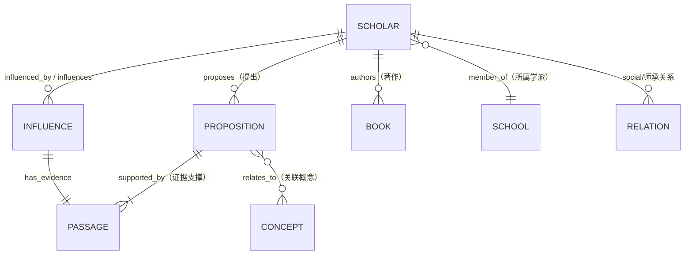

# 🗞️ 新闻传播学知识图谱 (News & Journalism Knowledge Graph)

> **一个证据可追溯、可视化呈现、人类可维护的新闻学与传播学学术知识图谱**  
> 收录中西方学者、理论命题、经典著作及其学术影响关系，支持中英文双语展示与互动博物馆式探索体验。

> **🖼️ 图文并茂升级**  
> 推荐在 `assets/screenshots/` 目录下添加真实截图（参见 [`assets/screenshots/README.md`](assets/screenshots/README.md)），使 README 更直观。

---

## 🌟 项目简介

你是否曾经想过：

- 麦克卢汉的“媒介即讯息”到底受谁启发？
- 李普曼的《舆论学》如何影响后世议程设置理论？
- 中国近代新闻思想与西方传播学派之间有哪些隐秘的对话？

这个项目就是为了回答这些问题而生！

我们构建了一个**结构化、可视化、可追溯**的知识网络，像一张“学术家族树”一样，把新闻传播领域的思想脉络清晰呈现出来。所有数据都来自公开文献，每一条连线都有证据支撑。

### 为什么选择这个项目？

| 痛点 | 本项目的解决方式 |
|------|------------------|
| 理论散落在各种教材和论文中，难以串联 | 结构化命题 + 影响关系，一目了然 |
| 想找原始证据却翻遍图书馆 | 每条命题绑定 passage 证据段落 + 来源链接 |
| 新手面对一堆学派名称不知从何学起 | 时间轴（中西对照）+ 知识图谱 + 主题导览 + 辩论场，循序渐进 |
| 想自己补充数据却不会写代码 | 纯 CSV 编辑 + 一键校验，新手友好 |

**适合人群**：
- 🎓 新闻传播专业本科生 / 研究生（复习神器）
- 👩‍🏫 高校教师（备课找案例、证据超方便）
- 🔬 传播学 / 新闻史研究者（快速定位影响链条）
- 🧐 对媒介与社会感兴趣的终身学习者

---

## 🚀 5 分钟快速开始（新手必看）

### 1. 环境准备

- **Python**：3.12 或更高版本（纯标准库即可运行，[下载地址](https://www.python.org/downloads/)）
- **浏览器**：推荐 Chrome / Edge / Firefox（最新版）
- **编辑器**（可选但推荐）：VS Code + “Edit CSV” 插件，或 Excel（保存为 UTF-8 without BOM CSV）

### 2. 获取项目

```bash
# 方式一：使用 Git（推荐）
git clone https://github.com/Yuuqq/news-journalism-kg.git
cd news-journalism-kg

# 方式二：直接下载 ZIP（GitHub 页面右上角 Code → Download ZIP）
```

### 3. 启动本地工作台（Workbench）

**Windows 用户（最简单）**：
```bash
# 双击运行
run_workbench.bat

# 或在命令提示符 / PowerShell 中执行
python workbench\server.py
```

**macOS / Linux 用户**：
```bash
python3 workbench/server.py
```

启动成功后，浏览器自动打开或手动访问：
**http://127.0.0.1:8125**

### 4. 探索功能（推荐顺序）

1. 先看 **Dashboard 概览** → 了解数据规模与快捷入口
2. 进入 **Scholars 学者名录** → 按学派筛选，点击卡片看详情（含学者金句与外部维基链接）
3. 切换到 **Timeline 时间轴** → 开启「中西对照」双栏模式，感受理论演进
4. 打开 **Graph 知识图谱** / **Influence 影响网络** → 单击聚焦影响半径，拖动「时间旅行」滑块观看网络生长
5. 体验互动博物馆模块 → **Concepts 概念网络**、**Tours 主题导览**、**Quiz 知识竞答**、**Game 六度连接**、**Debates 辩论场**、**Achievements 成就**
6. 最后去 **Browse 证据库** 深入挖掘原始文献段落

### 5. 数据校验

```bash
python scripts/validate_csv.py
```

### 6. 构建静态站点（部署用）

```bash
python scripts/build_static.py
```

构建脚本会将核心 CSV 与旁挂外部补全表合并输出到 `dist/` 目录，可直接部署到：
- Netlify（推荐，`netlify.toml` 已配置）
- GitHub Pages
- Vercel / Cloudflare Pages 等静态托管平台

---

## 🏗️ 项目结构一览

```
news-journalism-kg/
├── 📁 assets/
│   └── screenshots/              # 截图与指南（见 assets/screenshots/README.md）
├── 📁 data/csv/                  # ❤️ 核心数据（用 CSV 编辑即可贡献）
│   ├── SCHEMA.md                 # 数据结构详细说明（必读！）
│   ├── scholars.csv              # 学者（150+ 条）
│   ├── scholars_external.csv     # 学者外部补全旁挂表（维基链接、生卒年、证据 URL）
│   ├── propositions.csv          # 理论命题
│   ├── passages.csv              # 证据段落（文献原文摘录）
│   ├── influences.csv            # 影响关系（带证据）
│   ├── books.csv                 # 经典著作
│   ├── books_external.csv        # 著作外部补全旁挂表（维基链接、出版年核验）
│   ├── concepts.csv              # 核心概念
│   ├── quotes.csv                # 学者金句
│   ├── years.csv                 # 年份节点
│   └── relations.csv             # 社会/师承关系
├── 📁 dist/                      # 静态构建输出（含合并后的 api/db.json）
├── 📁 workbench/                 # 本地交互式工作台
│   ├── server.py                 # 轻量 Python HTTP 服务器（纯标准库）
│   └── static/
│       ├── index.html            # 主界面
│       ├── style.css             # 优雅排版（Merriweather + Inter 字体）
│       └── app.js                # 前端逻辑 + Vis.js 可视化 + 互动博物馆
├── 📁 scripts/                   # 工具脚本
│   ├── validate_csv.py           # 数据完整性校验（外键、必填、格式）
│   ├── build_static.py           # 导出静态站点（合并旁挂表）
│   ├── enrich_scholars.py        # 学者外部补全脚本（Tavily + 维基 opensearch）
│   └── enrich_books.py           # 著作外部补全脚本
├── run_workbench.bat / .ps1      # 一键启动脚本
├── config.json                   # 项目配置
├── netlify.toml                  # Netlify 静态部署配置
└── README.md                     # 你正在阅读的文档
```

---

## 📐 数据模型（核心概念）

项目采用**实体-关系**设计，所有数据最终可导出为 RDF（语义网）或导入 Neo4j。

### 核心实体关系图（Mermaid）



### 主要 CSV 表说明

| 表名 | 作用 | 关键字段示例 | 新手 Tips |
|------|------|--------------|-----------|
| `scholars.csv` | 学者基本信息 | `scholar_id`, `name_zh`, `name_en`, `school_id`, `active_year` | ID 用 `SCH_XXX` 格式 |
| `propositions.csv` | 学者提出的理论断言 | `proposition_id`, `scholar_id`, `proposition_text_zh`, `year`, `evidence_passage_ids` | 必须绑定至少 1 个 evidence |
| `passages.csv` | 文献证据段落（最重要！） | `passage_id`, `source_title`, `passage_text`, `source_url`, `locator` | 所有命题/影响的“根” |
| `influences.csv` | 学术影响关系（带证据） | `subject_id`, `object_id`, `evidence_passage_id`, `year`, `note_zh` | 必须有 `evidence_passage_id` |
| `books.csv` | 经典著作 | `book_id`, `title_zh`, `scholar_id`, `year` | 关联作者 |
| `concepts.csv` | 核心理论概念 | `concept_id`, `name_zh`, `description_zh` | 用于分类命题与概念共现网络 |
| `quotes.csv` | 学者金句 | `quote_id`, `scholar_id`, `quote_zh`, `quote_en` | 展示于学者详情 |
| `years.csv` | 年份节点（时间轴用） | `year_value`, `label_zh` | 辅助时间轴渲染 |

**多值字段约定**：用英文分号 `;` 分隔，例如 `evidence_passage_ids: PAS_0001;PAS_0007`

完整字段定义请查看 **[data/csv/SCHEMA.md](data/csv/SCHEMA.md)**（强烈建议贡献前阅读）。

### 学派分类

项目收录了以下学派的学者：

- **哥伦比亚学派** (`SCHOOL_COLUMBIA`) - 拉扎斯菲尔德、施拉姆等
- **多伦多学派** (`SCHOOL_TORONTO`) - 麦克卢汉、伊尼斯
- **法兰克福学派** (`SCHOOL_FRANKFURT`) - 哈贝马斯等
- **芝加哥学派** (`SCHOOL_CHICAGO`) - 拉斯韦尔等
- **伯明翰学派** (`SCHOOL_BIRMINGHAM`) - 霍尔等
- **中国改良派** (`SCHOOL_CN_REFORM`) - 梁启超、康有为、严复
- **中国革命派** (`SCHOOL_CN_REVOLUTION`) - 陈独秀、李大钊
- **中国民国派** (`SCHOOL_CN_REPUBLIC`) - 邵飘萍、张季鸾、史量才
- 以及更多...

---

## 🖼️ 功能模块详细导览

### 1. Dashboard 概览
- 统计卡片：学者数、命题数、证据覆盖率、著作数
- 快捷入口按钮与最近更新提示

### 2. Scholars 学者名录
- 学派筛选（哥伦比亚、多伦多、法兰克福、中国改良派、中国革命派、中国民国派…）
- 卡片式展示，点击弹出详情（生平、学者金句、代表命题、影响网络、相关著作与维基链接）

### 3. Timeline 历史时间轴
- 按年份展示理论命题和历史事件
- 支持「**中西对照**」双栏模式，直观对照中西方新闻传播思想演进

### 4. Graph 知识图谱（Vis.js 力导向图）
- 可视化学者与学派的关系网络
- 交互：拖拽、缩放、搜索高亮；**单击聚焦影响半径，双击查看详情**

### 5. Influence 影响网络
- 展示学术传承与影响关系的有向图
- 支持「**时间旅行**」滑块观看学术影响网络随年代生长

### 6. Books 经典著作
- 收录改变历史的学术名著，关联作者、年份与外部维基链接

### 7. Concepts 核心概念
- 概念卡片浏览与「**关联网络**」视图（概念共现图谱）

### 8. Tours 主题导览（互动博物馆）
- 策展式故事线：言论自由之路、媒介环境学之旅、从拟态环境到过滤气泡

### 9. Quiz 知识竞答（互动博物馆）
- 从命题/著作数据自动生成选择题，记录历史最佳成绩

### 10. Game 连接游戏（互动博物馆）
- 「**六度连接**」猜谜：猜测两位学者间的影响路径步数，用真实学术传承验证

### 11. Debates 辩论场（互动博物馆）
- 李普曼 vs 杜威、拉扎斯菲尔德 vs 阿多诺等经典论战的对峙视图

### 12. Achievements 成就系统（互动博物馆）
- 浏览学者、竞答、游戏、导览均可解锁成就，进度保存在本地

### 13. Browse 证据库
- 展示并全文搜索所有文献证据段落（含来源链接与出处类型筛选）

### 14. Data 数据录入
- 在线预览/编辑本地 CSV 数据文件并导出

### 15. Validate 校验工具
- 一键检查数据完整性和外键引用，报告缺失外键、格式错误与孤立节点

---

## 🧰 技术栈

- **后端**：Python 3.12+（纯标准库）
- **前端**：原生 HTML / CSS / JavaScript
- **图形库**：Vis.js
- **字体**：Merriweather + Inter (Google Fonts)
- **部署**：Netlify / GitHub Pages / Vercel / Cloudflare Pages（静态托管）

---

## 🔗 学者与著作外部补全（2026-09-17，Tavily + 维基 opensearch）

`data/csv/scholars_external.csv` 为**旁挂表**（核心 CSV 零改动）：`scholar_id` → 维基百科链接、生卒年、证据 URL。管线：维基 opensearch 精确定位条目（本机直连 wikipedia 不稳，带重试）→ Tavily extract 服务端抓页 → 解析生卒年（优先 infobox Born/Died 行，其次导语日期范围；排除「活跃年份」类括号如 `"(1921–1961)"`）。每行事实的证据 URL 即 `evidence_url`，符合本 KG「断言可溯源」原则。extract 结果缓存于 `data/enrich_cache/`（按 URL 幂等）。

```bash
TAVILY_API_KEY=xxx python scripts/enrich_scholars.py [--workers 6]
# 复用于其他同 schema 项目：
TAVILY_API_KEY=xxx python scripts/enrich_scholars.py --csv <path>/scholars.csv
```

首轮结果：158 位学者，wiki 链接 123、生卒年 113；9 位知名学者生卒年对照核验全对。`no_wiki_hit` 条目多为 opensearch 网络瞬断或确无维基页（部分中国报人），可清出后幂等重跑。

**著作补全（同日）**：`scripts/enrich_books.py` → `books_external.csv`（父项目 101 本：wiki 链接 65、出版年 verified 29；子项目 61 本：wiki 23、verified 19；mismatch 条目两侧年份并陈不覆盖）。集成：学者页书目带维基链接；workbench `/api/browse` 及静态构建（`scripts/build_static.py`）均已合并旁挂表（`merge_book_ext`）。注意维基 infobox 标签含不换行空格 `\xa0`，解析已内置归一化。

---

## 🎨 设计原则（项目灵魂）

1. **证据可追溯** — 没有 passage 支持的 proposition 不会被接受
2. **年份精确性** — 所有事件、命题精确到具体年份
3. **影响可解释** — 每条 influence 关系必须有文献证据
4. **人类可维护** — CSV + 稳定 ID + 分号分隔，**非程序员也能贡献**
5. **双语优先** — 中文为主，英文为辅，方便国际交流

---

## 🛠️ 常见问题 & 故障排除

**Q: 启动后浏览器打不开 127.0.0.1:8125？**  
A: 检查 Python 是否安装成功，端口是否被占用。尝试 `python -m http.server 8125` 测试基础服务。

**Q: CSV 中文乱码？**  
A: 必须使用 **UTF-8 without BOM** 编码保存。VS Code / Sublime Text 推荐。

**Q: 如何添加新学者？**  
A: 
1. 在 `scholars.csv` 新增一行（复制现有格式）
2. 如果有理论命题，在 `propositions.csv` 添加并关联 `evidence_passage_ids`
3. 证据必须先在 `passages.csv` 存在
4. 运行 `python scripts/validate_csv.py` 校验
5. 提交 PR 时说明来源文献

**Q: 数据可以导出成什么格式？**  
A: 目前支持 JSON（构建时生成 `dist/api/db.json`）和 RDF/Turtle（未来增强）。

**Q: 支持 Neo4j 可视化吗？**  
A: Schema 设计时已考虑，可通过脚本转换（欢迎贡献转换脚本！）。

---

## 🤝 如何贡献（欢迎 PR！）

我们非常欢迎以下贡献：
- 新增学者、命题、证据段落（**最需要**）
- 修正现有数据错误
- 改进前端交互或可视化效果
- 完善文档、添加截图（参见 [`assets/screenshots/README.md`](assets/screenshots/README.md)）
- 翻译英文内容

**贡献流程**：
1. Fork 本仓库
2. 在 `data/csv/` 中编辑（或新增）文件
3. 本地运行 `python scripts/validate_csv.py` 校验
4. 提交 PR，标题格式：`feat(data): 新增麦克卢汉相关命题及证据`
5. 在 PR 描述中附上证据来源链接或截图

**数据质量承诺**：我们只收录**有公开文献支撑**的内容。

---

## 📜 许可证

[MIT License](LICENSE)

---

## 🙏 致谢

感谢所有为新闻传播学发展贡献思想的学者们！  
特别感谢那些愿意把学术成果做成开放、可追溯资源的先行者们。

> **探索新闻传播学的学术脉络，从这里开始。**  
> **Trace the intellectual lineage of journalism and communication studies — starting here.**

---

**如果这个项目对你有帮助，请给个 ⭐ Star 支持一下！** 也欢迎在 Issues 中提出建议或报告 bug。

*最后更新：2026 年*
